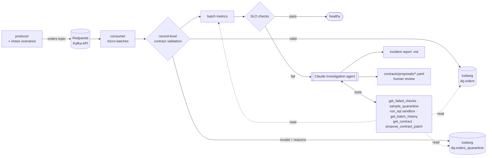

# dq-sentinel

**A streaming data-quality pipeline with a Claude agent on call.**
Events flow from Kafka (Redpanda) into Apache Iceberg. Deterministic checks validate every record
against a data contract and every batch against SLOs. When a batch fails, a Claude tool-use agent
works out *why*: it samples quarantined payloads, runs sandboxed SQL against the lake and compares
the batch with earlier traffic. It then decides whether the producer is broken or the contract should
evolve, and files an incident report. For a legitimate change, it also writes a reviewable contract patch.

[](https://github.com/jinwoojang21/dq-sentinel/actions/workflows/ci.yml)



## Why it's built this way

| Decision | Reason |
|---|---|
| **The LLM never decides *whether* data is bad.** Validation and SLO checks are deterministic. | Alerts stay reproducible and cheap. The model is only called when something has already failed, and only to explain it. |
| **Tools are read-only, except one that writes a proposal.** | The agent can't change the live contract or the lake. A contract change is written as a versioned YAML file plus a diff, ready for a PR. |
| **Contract changes are typed operations** (`rename_field`, `add_allowed_value`, …), not free-form YAML. | Proposals stay minimal, can be validated, and are easy to review. An invalid patch goes back to the model as a tool error. |
| **SQL runs in a sandbox.** Queries go to an in-memory DuckDB snapshot, with a single-statement SELECT/WITH guard, no external file access and a 50-row cap. | The agent can explore the data freely without being able to change anything or reach files outside the lake. |
| **Tool errors are returned to the model, not raised.** | The agent can recover from a bad query or argument. The loop has a turn budget and a fallback report, so it can't hang the pipeline. |
| **Scenario evals with a rule-based baseline** | Every failure mode has a graded expected outcome. The baseline uses the same `Toolbox`, so CI covers the full plumbing without an API key, and you can measure how much the LLM adds. |

## Quick start (no Kafka, ~10 seconds)

```bash
pip install -e ".[dev]"
cp .env.example .env            # add ANTHROPIC_API_KEY to use the Claude agent
dq-sentinel scenarios           # list failure modes
dq-sentinel demo --scenario schema_drift_rename
```

```
[OK  ] b00000  rows=500   quarantined=0
...
[FAIL] b00008  rows=500   quarantined=500    failed=['quarantine_rate', 'schema_unexpected_field:order_amount', 'schema_missing_field:amount']

  -> INC-0001: schema_drift (sev2, upstream_bug=False)
     report:   .dq/incidents/INC-0001.md
     proposal: contracts/proposals/INC-0001-orders.yaml
```

Without `ANTHROPIC_API_KEY`, the rule-based baseline investigates instead. Use `--agent claude|baseline|none` to choose.

## Full streaming stack (Docker)

```bash
docker compose up -d redpanda console                       # console at http://localhost:8080
docker compose up sentinel                                  # consumer + pipeline + agent
docker compose run --rm producer --scenario duplicates      # in another terminal
```

Iceberg tables, state and incident reports are written to `./.dq/`. Contract proposals go to `./contracts/proposals/`.

## Failure scenarios

| Scenario | What happens upstream | Expected verdict |
|---|---|---|
| `schema_drift_rename` | `amount` is renamed to `order_amount` | Contract change: propose `rename_field` |
| `new_category` | Currency `JPY` launches | Contract change: propose `add_allowed_value` |
| `type_change` | `amount` arrives as `"$12.50"` | Upstream bug |
| `null_spike` | 45% of events lose `channel` | Upstream bug |
| `duplicates` | Producer retries re-send 15% of events | Upstream bug |
| `volume_drop` | A partition goes quiet (~4% volume) | Upstream bug |
| `out_of_range` | Refunds encoded as negative amounts | Upstream bug |

## Evals

```bash
dq-sentinel evals --agent baseline   # runs in CI on every push
dq-sentinel evals --agent claude     # needs ANTHROPIC_API_KEY; also a manual CI job
```

Each scenario runs in a fresh lake: 6 healthy batches to build a baseline, then one bad batch.
The incident report is graded on **root cause**, the **upstream bug vs. contract change** call,
whether a **patch was proposed only when it should be**, and whether it includes **evidence**.

Baseline results:

| scenario | expected | got | cause | bug? | patch | evidence | result |
|---|---|---|---|---|---|---|---|
| schema_drift_rename | schema_drift | schema_drift | ✓ | ✓ | ✓ | ✓ | PASS |
| type_change | type_change | type_change | ✓ | ✓ | ✓ | ✓ | PASS |
| null_spike | null_spike | null_spike | ✓ | ✓ | ✓ | ✓ | PASS |
| new_category | new_category | new_category | ✓ | ✓ | ✓ | ✓ | PASS |
| duplicates | duplicates | duplicates | ✓ | ✓ | ✓ | ✓ | PASS |
| volume_drop | volume_anomaly | volume_anomaly | ✓ | ✓ | ✓ | ✓ | PASS |
| out_of_range | out_of_range | out_of_range | ✓ | ✓ | ✓ | ✓ | PASS |

The baseline only passes because it was written for exactly these seven failure modes. The Claude
agent gets no such rules: it has to reason from the tools, and it writes much richer evidence and
recommended actions. See [`docs/examples/`](docs/examples/) for a sample report.

## Project layout

```
contracts/orders.yaml           data contract (fields, types, enums, ranges, SLOs)
src/dq_sentinel/
  producer.py                   synthetic events + chaos scenarios
  kafka_io.py                   Redpanda producer / micro-batch consumer (manual commits)
  checks.py                     record validation, batch metrics, SLO checks
  lake.py                       Iceberg tables via pyiceberg (SQLite catalog, local warehouse)
  state.py                      DuckDB: batch metrics, check results, incidents
  pipeline.py                   batch → validate → write → check → investigate
  agent/tools.py                tool schemas + sandboxed executor + audit trace
  agent/loop.py                 Claude tool-use loop (turn budget, nudge, fallback)
  agent/baseline.py             rule-based investigator (same tools)
  evals.py                      scenario grading
tests/                          32 tests, incl. SQL-guard escapes and a scripted fake Claude client
```

## Roadmap

- Open the contract proposal as a GitHub PR automatically
- Iceberg schema evolution when a proposal is merged
- Cross-batch duplicate detection with Iceberg row lineage
- Slack/PagerDuty notification sink
- Terraform module for AWS (MSK, Glue catalog, S3 Tables)

## License

MIT
